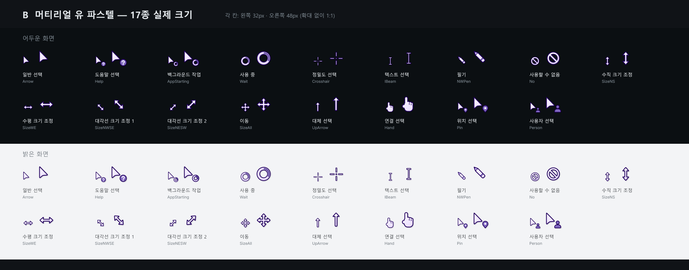
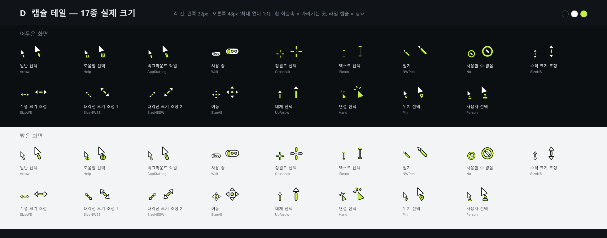

[English](README.md) | 한국어

# Petalpoint · Tailpoint

Windows 마우스 커서 팩 두 개입니다. 팩마다 Windows 커서 17종을 모두 담고, 파일 하나에 크기 다섯 가지가 들어 있으며, 우클릭으로 설치합니다.

## 팩

### Petalpoint

연보라 몸체에 짙은 남보라 테두리를 두른 파스텔 커서입니다. Material You의 톤 팔레트에서 영감을 받았습니다. 화살표는 꼬리 없는 다트 모양이고, 사용 중은 연보라 고리 위의 짙은 보라 호, 기본 화살표와 링크는 은은하게 숨 쉬듯 변합니다.

### Tailpoint

흰 화살촉과, 그 뒤를 떨어져 따라오는 라임 캡슐로 된 커서입니다. 라임 부분이 상태를 알려 줍니다. 도움말은 "?" 캡슐, 사용 중은 흰 캡슐 안의 라임 점 세 개, 링크는 라임 화살촉과 클릭 표시입니다.

## 특징

- 팩마다 Windows 커서 17종을 모두 담습니다.
- 파일마다 32·48·64·96·128px 그림이 들어 있어서, 화면 배율에 맞는 크기를 Windows가 골라 씁니다.
- 사용 중과 백그라운드 작업은 계속 돌고, 기본 화살표와 링크는 은은하게 숨 쉬듯 변합니다. 나머지는 멈춰 있습니다.
- `.inf` 파일을 우클릭해서 설치하고, 같은 방법으로 제거합니다.
- Windows 10·11에서 쓸 수 있습니다.

## 설치

1. [최신 릴리스](https://github.com/spilak0203-debug/petalpoint-tailpoint/releases/latest)에서 원하는 팩의 zip(`petalpoint.zip` 또는 `tailpoint.zip`)을 받아 **압축을 풉니다**. 폴더 하나(`petalpoint\` 또는 `tailpoint\`)가 나옵니다.
2. 그 폴더에서 **`install.inf`를 우클릭**하고 **설치**를 누릅니다. 메뉴에 없으면 **추가 옵션 표시**를 먼저 누릅니다. 커서 파일을 `C:\Windows\Cursors\<이름>`에 복사하므로 Windows가 관리자 권한을 묻습니다. **예**를 누릅니다.
3. **설정 → Bluetooth 및 장치 → 마우스 → 추가 마우스 설정 → 포인터**를 엽니다. 설치 후 이 창은 자동으로 열리지 않습니다. 구성표 목록에서 **Petalpoint** 또는 **Tailpoint**를 고르고 **적용**을 누릅니다.

> **주의**
> - 실제로 쓸 계정에서 설치합니다. 일반 계정으로 설치하면서 다른 관리자의 비밀번호를 넣으면, 구성표는 그 관리자 계정에 등록됩니다.
> - 설치하면 지금 쓰던 커서 설정이 백업 없이 바뀝니다. 되돌리고 싶으면 먼저 쓰던 구성표 이름을 적어 둡니다.

## 제거

압축을 푼 폴더는 지우지 말고 둡니다. 제거할 때 그 안의 `uninstall.inf`가 필요합니다.

1. 압축을 푼 폴더에서 **`uninstall.inf`를 우클릭**하고 **설치**를 누릅니다. 커서 파일 17개와 구성표 등록을 지우고, 커서를 **Windows 기본값**으로 되돌립니다. 그때 다른 구성표를 쓰고 있어도 기본값으로 바뀌니, 쓰던 구성표는 나중에 **포인터** 탭에서 다시 고릅니다.
2. 바뀐 커서는 로그아웃했다 다시 로그인하거나, **포인터** 탭을 열고 **적용**을 누르면 보입니다.
3. 커서 파일을 쓰는 중이면 Windows가 다시 시작하라고 할 수 있습니다. 빈 폴더 `C:\Windows\Cursors\<이름>`은 남습니다. 필요하면 직접 지웁니다.

## 문제 해결

- **커서가 바뀌지 않았다.** **포인터** 탭에서 구성표를 고르고 **적용**을 누릅니다.
- **zip 안에서 설치하다 실패했다.** zip을 먼저 풀고, 푼 폴더에서 설치합니다.
- **배율에서 흐려 보인다.** Windows는 화면 배율에 맞춰 다섯 크기 중 하나를 고릅니다. 설정 → Bluetooth 및 장치 → 마우스의 **포인터 크기**도 영향을 주니 함께 확인합니다.

## 라이선스

MIT 라이선스. Copyright (c) 2026 spilak0203. 자세한 내용은 [LICENSE](LICENSE)를 봅니다.

Google과 제휴하거나 Google의 승인을 받은 프로젝트가 아닙니다. 그 밖의 이름은 각 소유자의 것입니다.
